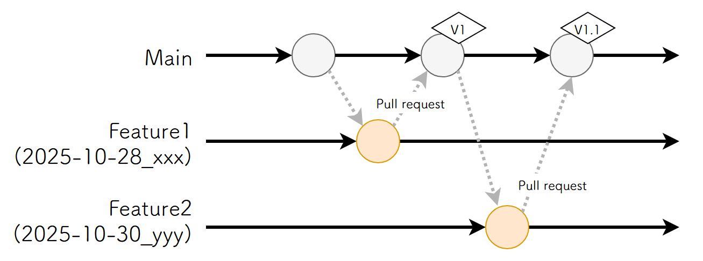
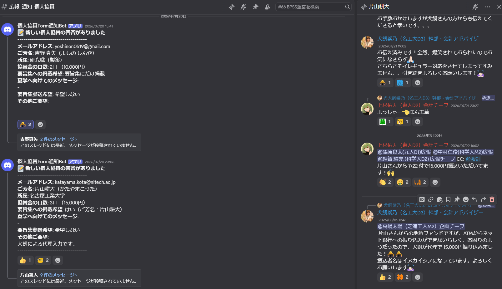
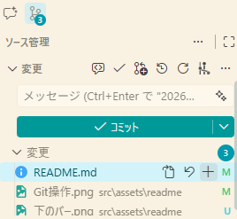
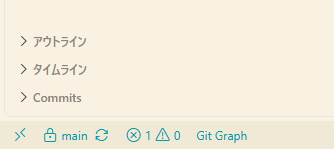

**BPSS2026 Web 引き継ぎ文書**

# 活動方針
- きれいなWebページを作成し保守管理する。
- Discordの運営をなんのトラブルも起こることなく行う

# 日程
- 10月26日: キックオフミーティング＆1st MTG
- 11月04日: 2nd MTG
- 01月20日: テンプレが決まる
- 02月04日: メインイラストのラフ画が来る→カラパレが決まる（今回はあまり意識していないが）
- 02月06日: 3rd MTG
- 02月16日: フォントが決まる
- 03月11日: コードを書き始める
- 03月31日: Web協賛ver（限定公開ver）を公開する（以降日程に合わせて随時アップデート）
  - 項目：開催日時、場所・暫定講師リスト・スタッフリスト・協賛募集・過去夏学リンク
- 05月下旬: 参加者用Discordの整備（チャンネル立ち上げ・ガイドライン作成）
- 06月08日: Webフルver（参加登録フォーム付き）を公開
- 06月08日: 参加者用Discord運用開始
- 08月17日: 参加者用HP運用開始
- 09月31日: オンデマンドの参加登録フォームを閉じる。HP更新作業終了
- 09月某日: 配信用リンクをまとめたNotionページを作成・公開。
- 11月31日: サーバー対応終了。サーバーをたたむ。

※ 日程には書かれていないが、適宜HP、Discordの保守・更新作業が入る。

【参考】2026の各係のスケジュール [https://docs.google.com/spreadsheets/d/1xempCX9Kdb0bIbPr8k8d53k5TqITXHJh5RuzinUjxOY/edit?usp=sharing](https://docs.google.com/spreadsheets/d/1xempCX9Kdb0bIbPr8k8d53k5TqITXHJh5RuzinUjxOY/edit?usp=sharing)

# スタッフ一覧
- 阿部潤（チーフ）
	- 北海道大学・M1
- 山口紗奈
	- 立命館大学・B4

# やること（要件定義・設計編）

## 技術選定
まずWebページは”HTML+CSS+Javascript”で作っています。Google site とか使ってもいいのですが、1年限りのプロジェクトで保守が不要なので、せっかくならかっこいいHP作りたいよねということです。

ただ、一から全てを書くのは超めんどくさいです。そこで一般的なWeb開発では、**フレームワーク**というものを使うそうです。

### Webフレームワークとは？
Webフレームワークは、Web開発で行われる共通した作業に伴う時間と労力を軽減し、開発効率を向上させることを目的として導入されます。 
一旦例を見てみましょう。次のようなコード（index.html）があったとします。

```html
<!-- index.html -->
 <!doctype html>
<html lang="en">
	<head>
		<meta charset="UTF-8" />
		<meta name="viewport" content="width=device-width" />
		<link rel="icon" type="image/svg+xml" href="/favicon.svg" />
		<meta name="generator" content={Astro.generator} />
		<title>Astro Basics</title>
	</head>
	
	<body>
		<h1> Hello world! </h1>
		<p> We are menbers of the BPSS2026 </p>
	</body>
	
</html>


<style>
	html,
	body {
		margin: 0;
		width: 100%;
		height: 100%;
	}
</style>
```

この`<head>` や`<style>`の部分は、 `index.html`だけでなく、他のファイルでも使い回されて然るべきものです。そこで次のようにします。

```javascript
<!-- index.astro -->
---
import Layout from '../layouts/Layout.astro';
---

<Layout>
	<h1> Hello world! </h1>
	<p> We are menbers of the BPSS2026 </p>
</Layout>
```

```html
<!-- Layout.astro -->
<!doctype html>
<html lang="en">
	<head>
		<meta charset="UTF-8" />
		<meta name="viewport" content="width=device-width" />
		<link rel="icon" type="image/svg+xml" href="/favicon.svg" />
		<meta name="generator" content={Astro.generator} />
		<title>Astro Basics</title>
	</head>
	<body>
	  <!-- ↓ここが違うポイント -->
		<slot />
		<!-- ↑ここが違うポイント -->
	</body>
</html>

<style>
	html,
	body {
		margin: 0;
		width: 100%;
		height: 100%;
	}
</style>
```

こうすると、Layout.astro モジュールを他のファイルでも使い回すことができ、効率化・ミスの減少・デザイン統一性の向上につながります。これがフレームワークを使う理由です。

フレームワークは様々あり、Reactなどが有名です。ただ、2024年担当者の髙橋さんはAstroを使っていました。理由は以下のとおりです。

> **2024HP係引き継ぎ（文責： 髙橋奏太（2024年度HPチーフ））より**
>
> 従来生物物理夏の学校（以下「夏学」）では、主にjsを含んだhtmlやcssの直打ちによって「静的サイト」と呼ばれる直接htmlファイルを閲覧するタイプのHPが製作されてきました。
> 
> 直打ちは非常に伝統的な手法で、今日の技術と比較するとたいへん効率が落ちるため担当学生の労力は甚大ですし、ミスも増大します。実際、トラブルがあって表示しないようにした個人情報が、html元ファイル（だれでも閲覧可能）を見るとコメントアウトされた状態で記載されていたという事案も発覚しておりますし、スマホへの対応も煩雑になってしまっていました。
> 
> このような手法が維持されてきた大きな理由をうかがったところ、
> 1. 複雑なサーバー管理体制に起因して、 Wordpress 等をサーバー側で利用するのが難しい
> 2. 毎年チーフが交代するため、高度な製作技術を導入しても技術継承が難しい
> 
> の2点があげられました。
> 
> 2024年度は、この2点に対して対策を行ったうえで、できる限りの効率化とミス減を図ってコードの製作と管理体制を構築しました。初めに、1.については情報に誤認があり、サーバー側で高度なシステム構築をしなくとも直打ちを回避した静的サイトの構築は可能です。
> 
> 2.については、2024年度は前任者からのアドバイザー体制やスタッフの全国区化などが行われ、技術継承のハードルがさがりました。そこで、2024年度は"静的サイトジェネレーター"を導入しました。
> 
> 前述のとおり、サーバー側にレンダリングやコンテンツ管理のシステムを必要としない一方で、テンプレートを用意して効率的なファイル管理が可能であることが導入理由です。中でも、主に髙橋が利用経験のあった Vue.js や TailwindCSS によるUI製作が可能であるという点で astro というフレームワークを選定しました。
> 
> また、** astro では便利なテンプレートが豊富に用意されていることも、今後の利用を考えると重要な点です**。2024年度はGoogleによる Pagespeed Score が良好な点、スマホ対応が良好な点から astroshipというテンプレートをもちいて製作を行うことにしました。
> 
> 静的サイトジェネレーターはほかにもさまざまありますので、その年にあったものを使うのが良いと思います。

特段使いづらさを感じない&テンプレートが豊富なことに変わりはないため、2026年もAstroを使っていました。

## テンプレート選定
フレームワークがあるとはいえ、一から全てコードを書くことは相当な労力がかかる。そのため、テンプレートを今回も使用する。[https://astro.build/themes/](https://astro.build/themes/) に色々あるので、ここからいいものを選ぶことになりそう。

ただし、今回は校長の目黒くんからデザインの希望「64回や65回のカラフルポップな感じというより、63回のような黒基調でかっこいい雰囲気」という希望があったため、**ダークモード対応かつかっこいい雰囲気のテンプレ**を探すと良さそう。

ということでテンプレが [Starlight Rapide](https://starlight-theme-rapide.vercel.app/) になりました。これ以外の理由として縦ナビゲーションバーのサイトを一回作ってみたいという個人的な思いもある。

## 配色・フォント選定
**ポスターや予稿集と揃える。デザイン係との連携が必須。**
配色はポスターの色をところどころ拝借すれば、デザインに大層な確認をしなくても大丈夫かも？フォントはちゃんと決めておく必要がありそう。
2026年は、カラパレについてはテンプレの色がほぼポスターの色だったのでそのまま採用。

フォントについては今年は無難に、基本フォントがNoto Sans JP, Noto Selif JP になりました。Google Fontだと無料かつ商用利用可だし。
ただ、「第66回 生物物理若手の会 夏の学校」と「SPIRAL」はイラストレーターの松野さんのものに似せたいなと思い、探した結果それぞれこうなりました。
- 第66回 生物物理若手の会 夏の学校: [https://fonts.google.com/specimen/Shippori+Mincho+B1](https://fonts.google.com/specimen/Shippori+Mincho+B1)
- SPIRAL: [https://fonts.google.com/specimen/Cinzel?preview.script=Latn&query=Cinzel](https://fonts.google.com/specimen/Cinzel?preview.script=Latn&query=Cinzel)

### フォント選定の際の注意点
フォントの注意点として、基本的にはGoogle Fontsなどのフリーフォントしか利用できない。これはWindows/Mac/Linuxで導入されているフォントが少しづつ違うことに起因する。

例えば2025年使用した筑紫A丸ゴシックはMacだと標準搭載である。このフォントを使用した場合、そのためMac環境であれば問題なく見れるかもしれない。しかしWindows環境だと多分他のフォントに置き換わってしまう。そのためWebフォントサービスやフリーフォントを使うのが一般的とされている。

ちなみに筑紫A丸ゴシックはフリーフォントではないため、本来は使用できないはずである。しかし阿部が所属する北海道大学は、教員に頼めばAdobeのライセンスがもらえる関係でAdobe Fontsを使うことができ、その中には筑紫A丸ゴシックが存在した。そのため、問題なく使用することができた。これはおそらく特殊事例なので留意すること。

また、フォントファイルを開発環境内に入れるセルフホスティングという方法もあるが、フォントによってはNGであるので留意すること。（[フォントをサーバーにアップしてWebフォントとして使う手順と方法を解説 | PLUSONEWEB](https://plusoneweb.net/210415/)）。

## 設計書作成
作成予定の全てのページについて、過不足ない掲載内容とレイアウト素案を記述する。作る目的としては、必要な情報を洗い出し整理するため、どのような情報の配列が見やすいかを絵で見てみるため、極力手戻りがないようにするため、など。そのため闇雲にコーディングスタートするのではなく、設計書を作ってからスタートすると、スムーズに行くと思っている（特に複数人で開発する場合には）。

必要な情報をより精度良く確認してもらうという観点では、**Web係だけでなく各係のチーフにも確認してもらったほうが良さそう**。テスト段階になって、各チーフの方から設計書の内容修正みたいなことが入ることも防げる気がする。けど追記したほうがいい情報って後で出てくるから、昨年の情報量・質を参考につくるのがよいかもしれない。

**ちなみに2027年はテンプレがまるっきり同じなので、設計書の作成は行わない。**

## コーディング環境の整備
GitHubのレポジトリを作って、それをどう運用するか（ブランチ戦略とか）を決める。
（Git/GitHubと、ブランチ戦略の詳細は後述。）

今年は参考元に習って、Github-flowというブランチ戦略を一部改変したものを使用します。
（参考：[https://techblog.insightedge.jp/entry/branch-strategy-github-flow](https://techblog.insightedge.jp/entry/branch-strategy-github-flow)）
使うブランチとしては、次の二種類です。
- main: 安定ブランチです。常にリリース可能なソースコードを管理します。
- feature: mainブランチから切ります。開発する機能に応じて作成します。
	- 命名法：自由。そんなに深く考えなくて良い 
（例：2025-10-27_sponsor、2025-10-27_abe）

手順としては以下のとおりです。
1. mainブランチからfeatureブランチを作成
2. featureブランチで開発完了後、mainブランチへPull Request
	- **プルリクを送るときは、`npm run build`** をして、問題なく出力できることをチェックすること
3. featureブランチの内容をレビュー。問題なければmainブランチにリポジトリ管理者がマージ
4. mainブランチにマージ後、本番サーバーへそのままリリース。  
	- バージョン管理はタグ付けすることにより実施する



### Git/GitHub
概念は https://www.youtube.com/watch?v=BNHrLHl1DKQ を参照
（チームみらいの人が出てきますが、政治的思想とは全く関係ありません。純粋にわかりやすいと思って掲載しています）

VSCodeと絡めた実践は https://qiita.com/yuchi0999/items/477a47dffec98a1611b1#%E9%96%A2%E9%80%A3%E3%83%AA%E3%83%B3%E3%82%AF がわかりやすい気がする

### ブランチ戦略
ブランチ戦略とは、複数人で効率よくソースコードを開発・管理するために、Gitなどのバージョン管理システムにおけるブランチの運用ルールや手順をあらかじめ定めた仕組みのこと。

詳細はこちら [https://techblog.insightedge.jp/entry/branch-strategy-github-flow](https://techblog.insightedge.jp/entry/branch-strategy-github-flow)

## 自動デプロイ設定
※ **2027年から生物物理若手の会のサーバーをCloudflare Pagesに移管するため、この対応は不要になります。** ただ記録として掲載します。

2025年にGithub Actionsを使ったデプロイの自動化に成功しました。2024年まではWinSCPなどのファイル転送ツールを用いてサーバーに手動でファイルをアップロードしていたが、**mainブランチでpullもしくはmain宛にpull-requestをすると、build後のものがサーバーに自動反映**されるようになりました。

BPSS2025レポジトリの`.github/workflows/action.yml` をコピペ改変して使用します。秘密鍵を変数に設定している関係で、変数はソースコード上になく、レポジトリの設定の `Secrets` → `Repository Secrets` に設定しています。

ただし、プルリク確認するときに、Buildが成功したかは確認する必要があります。`npm run dev` にうまくいった場合でも、`npm run build` するとエラーを吐いてしまう時があり、そうするとデプロイはできなくなる。今回度々そういう事があったので注意したい（自戒）。

## 掲載情報の取得方法を決める
Webに乗っける情報をどのように集めるかを決める。

スポンサー関連はDiscordにカテゴリチャンネルを設定し、種類ごとでスレッドを作成した（ [https://discord.com/channels/1409094265954373645/1488123373715329034](https://discord.com/channels/1409094265954373645/1488123373715329034) 参照）。2024年はGoogleフォームで収集していたが、Discord上で仕事を振る関係上、メッセージの転送とかできてこっちのほうがスムーズな気がする。

ただ、今年思ったこととして
- 個人協賛は本当にテンプレなので、今年と同じ感じなら個人協賛の振込確認メンションにWebを入れてもらうだけでいいかもしれない
  
- Webバナー、企業協賛一覧、共催/後援/助成団体はそのままでいいかも。特にまとまっているスプレッドシートとかなさそう

それ以外の情報は要旨集の掲載内容と被ってくるので、デザインと連携してやると情報統一がなされると思われる。

# やること（コーディング編）
## 入れるべき拡張機能（VSCodeの場合）
- Git Graph: 視覚的にコミット履歴を管理できる。全体的な流れを読むのが得意。
  - 使い方： [https://terrblog.com/vscode-git-graph/](https://terrblog.com/vscode-git-graph/)
- Git History: これも視覚的に全体的なコミット履歴を管理できるが、単一ファイルの流れを読むのが得意。
  - 使い方：[https://terrblog.com/vscode-git-history/](https://terrblog.com/vscode-git-history/)
- GitHub Pull Request: VSCode上でプルリクエストを送るために必須
  - 使い方：[https://qiita.com/nsadam5070/items/ca7b311d21f7e4d99f7b](https://qiita.com/nsadam5070/items/ca7b311d21f7e4d99f7b)
- Astro: Astroのフレームワークを使うため必須
- MDX: .mdxファイル（マークダウンファイルの亜種）を結構触るので必須
- Markdown All in One: マークダウンファイルも結構触るので必須
- SVG: SVGファイル（タイムテーブル）の編集で必須

## ディレクトリ構造
ここに記載のないファイルは基本触りません。

- public/ # アイコンやGoogle Search Consoleの設定ファイルが入っています。Webページで使う画像ファイルは src/assets に入れてください
- src/ # ソースコードが入っています。実際にいじるのはここ
  - assets/ # 画像置き場です
  - components/ # メニューバーなどの部品の構造やWebページの詳細なレイアウトが入っています
  - content/ # ページごとのや内容が入っています
    - docs # 日本語ページの内容を書くところ
    - i18n # 外国語ページの内容を書くところ（もしやるなら）
- astro.config.mjs # 拡張機能を入れるときなどに使用します
- preview.ps1 # ビルド→ブラウザ起動のバッチファイル
- README.md # 本文書（引き継ぎ文書）

## 基本的な流れ
※ 僕がやっているVSCodeでのやり方を併記していますが、別のやり方でも結果が同じなら問題ありません。

1. GitHub（オンライン）上の最新版のコードを取ってくる（"Pull"）。下記画像（サイドバー）の矢印が時計回りに回っているアイコンをクリックする。

   

2. 作業時、`main` を元として"Branch"を作成する（「"Branch"を切る」とよく表現されます）
   1. 下記画像（画面下部）の`main`と書いてあるところに他の文字が書いてある場合は、そこをクリックして`main`に変更する
   2. 下記画像（画面下部）の`main`と書いてあるところをクリックし、「新しいブランチの作成」をクリック
    
     
   
   3. ブランチ名を聞かれますが、少人数開発なのであなたがわかりやすいようにつけてくれればOK。考えすぎないでください。
   4. 下記画像（サイドバー）の「Branchの発行」をクリック

      
   - 一応機能ごとに"Branch"を切り分けるのが望ましいですが、少人数開発なのでそこまで要求しません
3. コードを編集したり、追加したりする
4. 変更を"Commit"する
   1. 下記画像（サイドバー）の変更を"Commit"したいファイルの横の"+"ボタンを押して、ステージングします
   2. コミットメッセージを入力します。基本的には何を変更したかを入力します。
   3. 「コミット」をクリック
   
      

   - コミットメッセージに何を変更したかを記入する関係で、なるべくコミットする単位は少ない方がいいです。コミットの数は多くても構わないので、なるべく分割してコミットするのが良いです。
5. "Commit"をGitHub（オンライン）上にアップロードする（"Push"）。下記画像（サイドバー）の矢印が時計回りに回っているアイコンをクリックする。

   

6. 変更を`main` に反映させるために、"Pull Request" を送る。
   1. 下記画像の赤線部をクリック

   

   2. フォーム作成される。基本的にはそのまま「create」でOK

   

   3. そのあとプルリクエストの表示画面になるが、"Merge Pull Request"を自分では押さないこと。
      - 管理者の阿部が押します。なぜならこれを押すとWebに反映されてしまうからです。 

※ **正しくWeb上で反映されているかを確認しながら進めてください。** 以下にやり方を記載します。

### 実際にサイトとして動かすには
```bash
npm install
npm run dev
```
します。すると、URLが出てくるのでそれをクリックすると見ることができます。

ただし、上記の方法だとビルド時のエラーを見過ごす可能性があります。ビルドしたあとのものを使った本番に近い環境でテストしたい場合は、
```bash
npm run build
```
をします。すると、distフォルダができるはずなので、生成を確認した後、
```bash
npm install -g live-server
live-server dist --entry-file=404.html
```
をします。すると勝手にブラウザが起動して確認が可能です。
ちなみに、windowsの方は`./preview.ps1`を走らせるとビルド→ブラウザ起動をすることができます

## テンプレ付属の装飾機能
テンプレに付属した装飾機能があって、以外と使い所があると思う。詳細は 
[https://starlight-theme-rapide.vercel.app/examples/kitchen-sink/](https://starlight-theme-rapide.vercel.app/examples/kitchen-sink/)

## タイムテーブル
2025年で初めて導入したタイムテーブル内にリンクを埋め込む方式が割と好評だったので、今回も継続したい。2025年はタイムテーブル作成を阿部が自分でやっていたが、今年はデザイン班に投げた。SVGで返してもらって、リンクの埋め込みはWebでやった。やり方は次の通り。
1. イラレなどでタイムテーブルを作る
2. svgファイルで出力する
3. 出力したsvgファイルのリンクを付けたいところに\<a>タグでリンクを付ける
4. 更新するときは差分だけコピペするのが良い。\<a>タグを付け直すのは相当しんどい  
5.  [Images](https://docs.astro.build/en/guides/images/#svg-components) を参考に、SVGファイルをアップロードする（通常の画像の表示方法と異なるので注意）   

## Google Search Console・Google Analyticsの導入

[https://satori.marketing/marketing-blog/google-search-console/](https://satori.marketing/marketing-blog/google-search-console/) に必要なことは大体書いてあります。

Googleにクロールされるには、Google Search Consoleでリクエストをする必要がある
テンプレでastroshipみたいに`sitemap.xml`を生成してくれるのを選ぶとよい。

↑について、astrojs/sitemapを入れると出力される。

### 留意事項
以下の理由により、 インデックス設定時にエラーが出る可能性がある。全てのページがインデックス登録されていれば問題ないので、確認すること。
> 生物物理若手の会では、若手の会自体のHPと夏学HPで同一のサーバーを利用して運用をしている。若手の会のHPを2025年にGoogleサイトに移行した関係でURLが変更になった。
> 旧：bpwakate.net
> 新：https://sites.google.com/view/bpwakate
> 
> これにより、旧URLから新URLへのリダイレクトをするために、以下のプログラムが仕込まれている

``` javascript
# If the user accesses "bpwakate.net", they will be redirected to Google Sites.
RewriteCond %{HTTP_HOST} ^bpwakate\.net$
RewriteRule ^$ https://sites.google.com/view/bpwakate [R=301,L]
RewriteCond %{REQUEST_URI} ^/index\.html$ [NC]
RewriteRule ^(.*)$ https://sites.google.com/view/bpwakate [R=301,L]
```

## Cloudflare workers設定
- wranglerを入れる
- "wrangler.jsonc"をルートディレクトリに作成し、下記のようにする
```jsonc
  {
  "$schema": "./node_modules/wrangler/config-schema.json",

  // ダッシュボードのWorker名（githubのリポジトリ名）と一致させる
  "name": "bpss2026",
  
	// 作業開始日を書く
  "compatibility_date": "2026-11-04",

  "assets": {

		//  "npm run build" を実行したら生成されるディレクトリの宛先を入れる
    "directory": "./dist",

		// 年を今年のものに変更すること
    // ドメインをさくらサーバーからcloudflareに変更したらコメントアウトを外す
    // "base_path": "/summer2026",

    // Starlight が出力する 404.html を返す
    "not_found_handling": "404-page"
  },

  // ログの閲覧設定
  "observability": {
    "logs": {
      "enabled": true,
      "invocation_logs": true,
      "persist": true
    }
  },

  // プレビューの設定。これがないと wrangler dev でプレビューできない。
  "previews": {},

	//  独自ドメイン（"bpeakate.net"）を使っているため、ルーティング設定を行う。
  // ドメインをさくらサーバーからcloudflareに変更したらコメントアウトを外す
  // "routes": [
  //   { "pattern": "bpwakate.net/summer2026*", "zone_name": "bpwakate.net" }
  // ]
}
```

## その他
- astroはこの案件にとても向いている良いフレームワークですが、実はルーティングでちょっと苦労しました（`www`直下ではない子フォルダになることが原因と思います）。デフォルトがたぶん絶対リンクで、そちらでうまくいけばその方がいいですが、相対リンクにするのはたぶん必須かもと思います。今回のを参考に、よくわからないところがあれば聞いてください。 
	- これを入れる→ import relativeLinks from "astro-relative-links"**;**

## Basic認証
テスト公開のときにBasic認証をかける。詳細は[こちら](https://help.sakura.ad.jp/rs/2196/)。でもCloudflare Pagesへの移行に伴って不要になるかも。

# やること（その他編）
## Discord運営
別資料参照

## 参加者専用ページ・配信ページの作成
参加者専用ページは、2024年の反省を元に2025年から復活させたページ。みんなでいじれるようにNotionで作成。2025年のものを使い回していいと思われる。

ただ、参加者用ページはなんだかんだみんなpdfに鍵をかけちゃうので、そのままWebに流してもいい気がする。日本生物物理学会もそうしている。

配信リンクをまとめたページも、Web係以外の人がいじる可能性を考慮して、Notionで作っている。

## 予算申請
（有料テンプレを使わない限り）なし

※ 2026年はサーバー代を生物物理若手の会（本体）が払うのでなし。2025年までは本体に収入源がなかったので夏学会計で予算申請していた。2027年はどうするか知らないが、費用が10000円→2000円程度まで削減されるので多分本体が払うんじゃないかと。

# 連携
## 講演・企画・会場・広報
- 情報をもらう

## デザイン
- デザイン統一してもらう
- バナー画像の作成など、細かなデザイン物の作成を投げる。
- **デザインとHPで他の係からもらう情報がかぶるので、そのリストアップ・管理も共通してやると良き。**

## 広報
- 広告協賛資料に載せるHP画像の敲きを一緒にやる。

## 校長・教頭
- 助成金などの情報掲載時に連携

# 自由記述欄
## 阿部
- 来年の目標は属人化をできるだけ無くすこと

## 山口

## その他の人