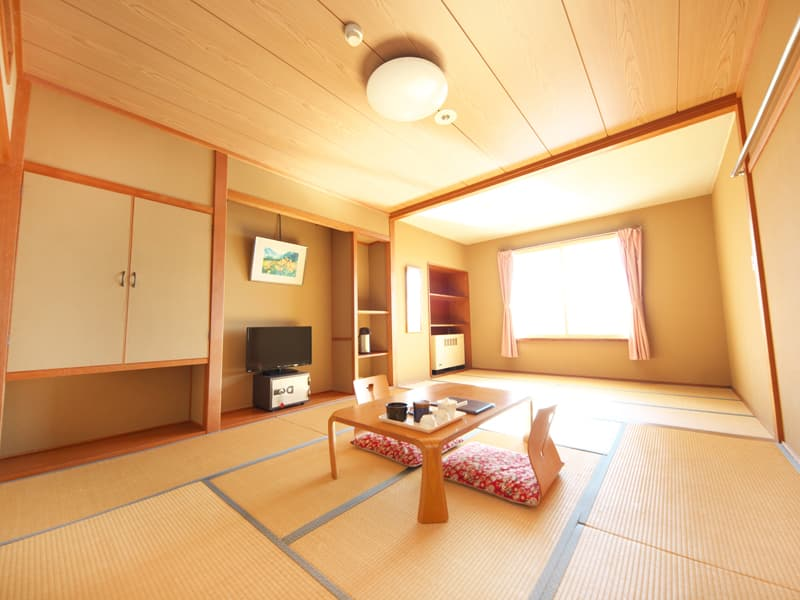
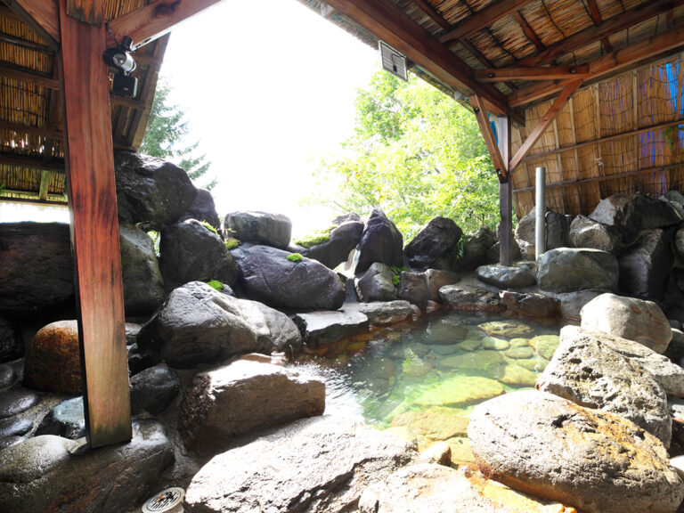

## 客室での過ごし方について

### 🐒 サルにご注意ください

- 施設内の**窓は絶対に開けないでください**。窓の開閉は運営が対応するため、参加者は窓を触らないようお願いいたします。
- 屋外へ飲食物（ビニール袋を含む）を持ち出す際は、サルに奪われる可能性があるため十分ご注意ください。

### 🍽️ 客室での飲食について

- 客室内での飲食は可能です。
- 火気を使用した調理は禁止されています。
- **カップラーメンなどのお湯を注ぐ程度の利用は可能**です。
- **カセットコンロの客室への持ち込みは禁止**されています。

### 🐝 虫対策について

- 客室内や屋外で虫が出る可能性があります。必要に応じて、各自で虫よけ用品をご持参ください。
- ハチがいる場合もあるため、**黒い服装は避けることを推奨**します。

### 🌡️ 室温・気温について

- **客室に冷房設備はありません。**
- 会場周辺は東京と比べて **10〜15℃ほど涼しい環境**です。
- 夜間は半袖では少し肌寒く感じる場合があります。必要に応じて、羽織れる上着などをご持参ください。
- 室内の空気がこもり、暑く感じる可能性があります。

## アメニティについて

### 🏨 客室の外観

- 以下のような外観となっております。

### 🛏️ 客室の部屋割りについて

- 特別な理由がない限り、1人部屋の対応はできかねます。ご了承ください。

### 🛁 備え付けのアメニティ

- **フェイスタオル・歯ブラシ・バスタオルが用意されています。**
- フェイスタオルと歯ブラシは、必要な方のみフロントで受け取ってください（1日につき1セットまで）。
- バスタオルは各部屋に備え付けられています（交換はありません）。

### 👕 パジャマについて

- **パジャマの用意はありません。**
- 必要な方は、各自でご持参ください。

### 💨 ドライヤーについて

- **ドライヤーの持参を推奨します。**
- 備え付けのドライヤーは風量が弱いため、気になる方はご自身でご準備ください。
- ただし、**同じ部屋で2台以上のドライヤーを同時に使用すると、ブレーカーが落ちる可能性があります。**
- ドライヤーを持参する場合は、同室の方と使用時間を調整してください。

## 施設内の設備等について

### 🍽️ 講演・ポスター会場内での飲食について

- **会場内での飲食は可能です。**
- ゴミは必ず分別してください。
- 特に酒類の容器は、処分しやすいよう適切な分別にご協力をお願いします。

### 💧 飲料水について

- **水道水をそのまま飲むことができます。**
- 水質が非常に良いため、水筒を持参すると便利です。

### 👕 コインランドリー

- 大浴場横に洗濯機2台、乾燥機2台を設置しています。
- 洗剤は別売りで、フロントで購入できるほか、持ち込みも可能です。

### 🏪 売店について

- **売店では軽食を購入できます。**
- 冷凍パスタやカップ麺などを販売しています。
- 酒類・タバコ類の販売はありません。
- 夜間は営業していないため、必要なものは事前に購入しておくことを推奨します。
- 支払い方法は、**現金またはPayPay**です。

### 🚬 喫煙について

- **喫煙所は3階・5階・玄関付近に設置されています。**
- タバコの販売はないため、必要な方は事前に購入してください。

### ♨️ 温泉について

- **施設内に温泉があります。**
- 毎日 **9:00〜12:00** は清掃時間のため利用できません。
- また、温泉とは別に宿泊部屋にも浴室があります。ご自由にお使いください。

### 🔌 コンセントの利用について

- **会場内のコンセント数には限りがあります。**
- スマートフォンやPCなどの充電は、できるだけ各自の部屋で済ませるようお願いします。
- 電源タップの使いすぎや複数機器の同時利用により、ブレーカーが落ちる可能性があります。

## 通信環境について

### 📶 Wi-Fi・通信環境について

- **通信環境が不安定な場合があります。**
- 講演会場では、キャリア回線（携帯電話回線）がつながりにくい、または利用できない可能性があります（docomoは比較的つながりやすいようです）。
- 発表資料や必要なファイルは、事前にダウンロードしておくことを推奨します。

## 近隣施設について

- **周辺には店舗や医療機関がほとんどありません。**
- 必要なものは事前に購入・準備しておくことを推奨します。

| 施設   | 所要時間（車） |
| :--- | :-----: |
| コンビニ |   約40分  |
| 病院   |   約50分  |

