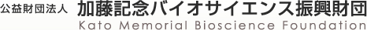
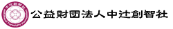
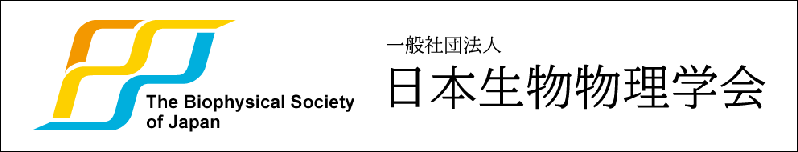

第67回生物物理若手の会夏の学校では、本年度も助成財団、企業、団体の皆様にご協賛を賜りました。
心より感謝申し上げます。
また、個人としてご支援いただいた皆様にも、深く御礼申し上げます。

皆様からのご支援により、本活動が成り立っていることを改めて実感しているとともに、皆様のおかげで参加者同士の交流や研究の発展の機会を提供することができております。
第67回生物物理若手の会夏の学校では、本年度も助成財団、企業、団体の皆様にご協賛を賜りました。
心より感謝申し上げます。
また、個人としてご支援いただいた皆様にも、深く御礼申し上げます。

皆様からのご支援により、本活動が成り立っていることを改めて実感しているとともに、皆様のおかげで参加者同士の交流や研究の発展の機会を提供することができております。

## 共催

学術変革領域(A)「動的物質科学」

## 助成

公益財団法人 テルモ生命科学振興財団

加藤記念バイオサイエンス振興財団

公益財団法人中辻創智社

## 後援

一般社団法人 日本生物物理学会

## 企業・団体協賛(五十音順)

株式会社アプコ

株式会社イナ・オプティカ

株式会社エビデント

MDPI

沖縄科学技術大学院大学（OIST）

オックスフォード・ナノポアテクノロジーズ

シグマ光機株式会社

株式会社ステム

株式会社生体分子計測研究所

ソーラボジャパン株式会社

タイテック株式会社

株式会社tayo

株式会社髙長

東京化成工業株式会社

ナカライテスク株式会社

株式会社ニコンソリューションズ

株式会社ニレコ

株式会社バイオモデリングリサーチ

分子科学研究所（総合研究大学院大学分子科学コース）

株式会社　羊土社

## 個人協賛（五十音順・氏名掲載許諾者のみ）

荒谷 剛史 様

落合 佳樹 様

片山 耕大 様

加藤 修三 様

鹿毛 あずさ 様

小谷 則遠 様

杉浦 雅大 様

高橋 大地 様

武井 梓穂 様

冨樫 祐一 様

鳥羽 栞 様

夏学OB 様

堀池 由朗 様

水鳥 律 様

森 義治 様

合計21名（匿名希望者を含む）
